# Qryptana Android UI Implementation Plan

## 1. Scope & Execution Principles

This implementation plan defines the step-by-step roadmap for executing the approved Android visual direction across all 44 user-visible screens and states discovered in the inventory.

### Non-Negotiable Boundaries:
1. **Preserve Desktop & iOS Integrity**: Shared Compose code in `commonMain` must use guarded platform branches (`if (appPlatform.isAndroid)`), expect/actual declarations, or platform-scoped palette selectors (`ThemeDefaults.androidPalette()`). Desktop's black-titanium appearance must remain completely untouched.
2. **Preserve Functional & Cryptographic Behavior**: No modifications to protocols, database schemas, cryptographic operations, routing, server selection, push services, or navigation graph destinations.
3. **Preserve Approved Brand Artwork**: The canonical Qryptana symbol (`qryptana-symbol.png`) and wordmark (`qryptana-wordmark.png`) must be rendered directly without tinting, color filters, shaders, or redraws.
4. **Preserve License & Attribution**: No edits to license notices, upstream headers, or attribution files.

---

## 2. Token & Component Mapping Architecture

Every discovered surface maps cleanly onto standardized design tokens and reusable components:

```mermaid
flowchart TD
    subgraph Tokens ["Semantic Design Tokens"]
        T1["Charcoal Background #0E1013 (Dark) / #F1F3F5 (Light)"]
        T2["Titanium Surface #161A1F (Dark) / #FCFDFE (Light)"]
        T3["Raised Surface #1E232A (Dark) / #FFFFFF (Light)"]
        T4["Silver Primary Text #DDE2E8 (Dark) / #20262B (Light)"]
        T5["Silver Secondary Text #9BA4AF (Dark) / #59636C (Light)"]
        T6["Muted Titanium Border #6A737E (Dark) / #7C858D (Light)"]
        T7["Action Copper #D3A78F (Dark) / #80513E (Light)"]
        T8["Filled Control Copper #9F634C (4.81:1 Thumb Contrast)"]
    end

    subgraph CoreComponents ["Reusable Core Components"]
        C1["DefaultAppBar (Titanium surface + 0.5dp border)"]
        C2["SectionView & SectionItemView (48dp min touch target)"]
        C3["DefaultSwitch (Verified accessible copper track/thumb)"]
        C4["SimpleButton (48dp min bounding box)"]
        C5["SearchTextField (Recessed titanium well)"]
        C6["QryptanaAndroidSmartInvite (Clean black/white QR)"]
        C7["QryptanaAndroidInvitationCard (Compact horizontal card)"]
        C8["ModalView & BottomSheet (24dp top radius, dark scrim)"]
    end

    subgraph SurfaceMapping ["Surface Implementations"]
        S1["Onboarding Flows (Steps 1–5)"]
        S2["Chat List & Search"]
        S3["Active Conversation & Composer"]
        S4["Invitations & Address Management"]
        S5["Settings & Sub-Settings Hub"]
        S6["Audio/Video Calling (CallActivity)"]
        S7["Modals, Dialogs, Alerts & Menus"]
    end

    Tokens --> CoreComponents
    CoreComponents --> SurfaceMapping
```

---

## 3. Phased Implementation Roadmap

### Phase 1: Foundation Tokens & Palette Elimination of Warm Brown Cast
*Goal: Correct semantic color roles, purge all remaining warm brown/tan message bubble tones, and verify WCAG contrast.*

1. **Step 1.1: Update `Color.kt` Semantic Roles**
   - Update `QryptanaAndroidThemeRoles.dark`:
     - `sentMessage`: Change from warm brown `#3A2B24` to **Raised Cool Titanium `#1E232A`**.
     - `sentQuote`: Change from `#4A3428` to **Recessed Titanium `#121519`**.
     - `receivedMessage`: Change from `#2B2926` to **Titanium Surface `#161A1F`**.
     - `receivedQuote`: Change from `#3A3733` to **Recessed Titanium `#121519`**.
   - Update `QryptanaAndroidThemeRoles.light`:
     - `sentMessage`: Change from warm peach `#F1DFD3` to **Cool Silver-Grey `#E1E5EA`**.
     - `sentQuote`: Change from `#E7C6B0` to **Cool Neutral Recessed `#D9DEE4`**.
     - `receivedMessage`: Change from warm ivory `#FFFBF7` to **Pure Crisp White `#FFFFFF`**.
     - `receivedQuote`: Change from `#E9E2DB` to **Cool Neutral `#E8ECEF`**.
   - Ensure desktop color constants (`QryptanaDarkBackground`, `QryptanaMetal.*`) remain 100% untouched.

2. **Step 1.2: Refine `QryptanaMessagingTokens.kt`**
   - Update `qryptanaThemeTokens()` on Android:
     - Bind `sentMessage` and `receivedMessage` strictly to the cool semantic roles.
     - Enforce `messageCornerRadius = 14.dp`.
     - Enforce `controlHeight = 48.dp` (up from 44.dp to guarantee accessibility).
     - Bind `inputSurface` to `#161A1F` (dark) and `#FCFDFE` (light).

3. **Step 1.3: Update and Execute Test Suite**
   - Run `:common:desktopTest` to verify that `ThemesTest.kt` passes with updated bubble contrast assertions.
   - Assert contrast:
     - Sent message text (`#DDE2E8`) against sent bubble (`#1E232A`) ≥ 12.1:1.
     - Received message text (`#DDE2E8`) against received bubble (`#161A1F`) ≥ 13.4:1.
     - Desktop palette assertions remain 100% identical.

---

### Phase 2: Core Components & Android Touch Target Compliance
*Goal: Ensure all interactive components meet the 48dp touch target standard, refine borders, and standardize modal surfaces.*

1. **Step 2.1: Enforce 48dp Minimum Touch Targets**
   - `SimpleButton.kt`: Add `.defaultMinSize(minWidth = 48.dp, minHeight = 48.dp)` to `SimpleButtonFrame`.
   - `Section.kt`: In `SectionItemView` and `SectionItemViewSpaceBetween`, ensure row height is constrained with `.defaultMinSize(minHeight = 48.dp)`.
   - `SearchTextField.kt`: Ensure trailing clear button icon has a 48dp hit area.
   - `DefaultTopAppBar.kt`: Ensure navigation icon and action buttons have 48dp hit slop.

2. **Step 2.2: Standardize Dialog & Modal Surfaces**
   - `ModalView.kt`: On Android, set sheet background to Raised Titanium `#1E232A`, top corner radius to 24dp, and add a subtle 4dp titanium drag indicator.
   - `DefaultDialog.android.kt`: Set dialog window surface to `#1E232A` with 20dp corner radius and 0.5dp border (`#6A737E`).

3. **Step 2.3: Purge Obsolete Sweep Gradients from Fallback QR Paths**
   - In `apps/multiplatform/common/src/commonMain/kotlin/chat/simplex/common/views/newchat/QRCode.kt`, remove the obsolete cyan/purple sweep gradient (L194–200) from the fallback path, ensuring that if any non-Android branded path ever triggers, it falls back to a clean titanium stroke.

---

### Phase 3: Screen-by-Screen Visual Polish (Surface Groups)

#### Group 1: Onboarding Experience (Screens 1–8)
- Preserve canonical unshaded wordmark and symbol.
- Replace empty 24×24 illustration placeholders with structured titanium icon plates.
- Ensure profile name input has a 1dp titanium border with a copper focused highlight.
- Validate on narrow 320dp/360dp screens that text does not truncate or wrap awkwardly.

#### Group 2: Chat List, Search & Tag Filters (Screens 9–13)
- Style horizontal invitation cards (`QryptanaAndroidInvitationCard`) with 14dp corners and restrained copper glyph.
- Replace bright blue unread badges with copper badges (`#9F634C` fill / `#FFFFFF` text).
- Style tag chips as titanium pills (`#161A1F`) with a 1dp copper border when active.
- Refine `UserPicker` bottom sheet with titanium card styling and clear active user indicator.

#### Group 3: Active Conversation & Composer (Screens 14–28)
- Apply cool titanium sent (`#1E232A`) and received (`#161A1F`) message bubbles.
- Update quote indicators to a 2.5dp vertical copper stroke (`#B87333`) on a recessed cool titanium plate.
- Update timestamps to muted titanium (`#9BA4AF`) and read ticks to copper (`#B87333`).
- Style the composer bar (`SendMsgView`) with a 20dp pill input field, 1dp titanium border, and 48dp copper send button.
- Restyle voice playback waveform and file attachment cards with precision titanium plates and copper progress accents.

#### Group 4: Settings, Privacy & Data Management (Screens 31–41)
- Group settings into clean titanium card sections (`#161A1F`) on charcoal canvas (`#0E1013`).
- Use neutral silver icons (`#9BA4AF`) for standard settings rows.
- Restrict warning colors strictly to true risk states (unencrypted database, destructive delete).
- Present encryption passphrase change with prominent dual confirmation cards.

#### Group 5: Calling UI & System Bar Integration (Screens 29–30, 42–44)
- Style `CallActivity` with a deep titanium canvas (`#0E1013`), large circular titanium controls (56dp), and a prominent crimson end-call button.
- Ensure incoming call banners float with titanium elevation and distinct green/red action buttons.
- In `MainActivity.kt` and `SimplexApp.kt`, configure system bars:
  - Transparent navigation bar on Android 11+ (API 30+).
  - Dark status bar icons on Light theme; silver icons on Dark theme.
  - Window background in `themes.xml` aligned to Charcoal `#0E1013`.

---

## 4. Cross-Platform Guardrails & Verification Matrix

To ensure future implementation does not regress Desktop or iOS, all changes must pass this sequential check gate:

| Step | Command / Check | Verification Target |
|---|---|---|
| **1. Source Diff Check** | `git diff --stat apps/multiplatform/desktop/` | **Zero changes** to desktop-specific code files. |
| **2. Palette Assertions** | `./gradlew :common:desktopTest --tests chat.simplex.app.ThemesTest` | Tests verify: desktop black palette is unchanged; Android palettes meet WCAG contrast; roles remain distinct. |
| **3. Android Compilation** | `./gradlew :common:compileDebugKotlinAndroid :android:compileFossDebugKotlin` | Zero syntax or type errors in shared or Android actuals. |
| **4. Android Assembly** | `./gradlew :android:assembleFossDebug` | Produces ARM64 and ARMv7 debug APK splits. |
| **5. APK Signature** | `apksigner verify --verbose <apk-path>` | Verifies APK Signature Scheme v2. |
| **6. Visual Rendering** | Browser inspection of HTML Proposals & local preview | Verify zero brown/tan cast, 48dp touch targets, font scaling at 1.3x. |

---

## 5. Accessibility, Ergonomics & Internationalization Standards

1. **Touch Targets**:
   - Every clickable button, chip, icon button, and switch must have a touch bounding box of at least **48dp × 48dp**.
   - Compact visual icons (e.g. 24dp chevron) must use padding or `Modifier.defaultMinSize(48.dp)` to provide the required hit target without ballooning visual geometry.
2. **Text Scaling & Insets**:
   - Layouts must be tested at **1.3x and 1.5x font scale**.
   - Fixed heights (`height(50.dp)`) must be avoided on rows containing text; use `heightIn(min = 48.dp)` with wrapping content to prevent text clipping.
   - Screen margins must consume `WindowInsets.safeDrawing` to properly clear Android camera punch holes and gesture bars.
3. **Contrast Compliance (WCAG 2.1 AA / AAA)**:
   - Normal text: ≥ 4.5:1 against adjacent background (achieved: 10.7:1 to 16.7:1).
   - Essential icons and borders: ≥ 3.0:1 (achieved: 3.5:1 to 8.3:1).
   - Filled controls (switch thumbs, buttons): ≥ 4.5:1 with foreground text (achieved: 4.81:1 with white on `#9F634C`).
4. **TalkBack & Screen Readers**:
   - All interactive icons must provide localized `contentDescription` from `MR.strings.*`.
   - Decorative icons must use `contentDescription = null`.
   - Custom clickable containers must declare appropriate `Role` semantics (`Role.Button`, `Role.Switch`, `Role.Tab`).
5. **Reduced Motion**:
   - Respect system `isReducedMotionEnabled`. When enabled, animations (e.g. screen transitions, pulse effects) must snap immediately without spring interpolation.
6. **RTL & Long Localization Strings**:
   - Use `Modifier.padding(start = ..., end = ...)` instead of `left`/`right`.
   - Flexible text wrappers with `TextOverflow.Ellipsis` on title rows and unlimited wrapping on dialog body text.
